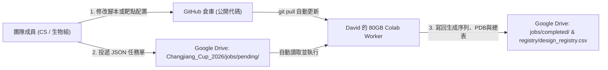

# 長江杯 2026 全球 AI 蛋白質設計挑戰賽 — CUHK 團隊 Pipeline

本倉庫為香港中文大學（CUHK）參賽團隊的自動化蛋白質設計、質量門禁與評估流水線（基於 **80GB Colab GPU + GitHub 代碼同步 + Google Drive 任務隊列**）。

---

## 1. 核心架構：如何在不共享帳號密碼的情況下協作與調用 80GB 算力？



> **安全紅線**：長江杯規則規定「若不同團隊提交相同序列，優先歸屬最早提交者」。因此 **所有生成的候選序列（`.fasta` / `.csv`）與模型預測產物嚴格只存放在團隊共享 Google Drive（`Changjiang_Cup_2026`），絕不進入 GitHub**（已由 `.gitignore` 強制攔截）。

---

## 2. 主攻賽道與靶點狀態

| 靶點編號 | 靶點名稱 | 賽道分子類型 | 長度要求 | 特殊要求 | 當前狀態与輸入路徑 |
| :--- | :--- | :--- | :--- | :--- | :--- |
| **Target 1** | **EGFR** | **VHH（奈米抗體）** | 100–150 aa | **pH 6.0 親和力測定** | ✅ 生物組已交付 v2 定版 [`targets/target1_EGFR/`](./targets/target1_EGFR/README.md)（預設使用 `t1_4KRP_domIII.pdb`） |
| **Target 5** | **TL1A** | **Minibinder（迷你結合蛋白）** | 40–100 aa | 無特殊附加條件 | ✅ 已準備單體零殘缺結構 [`targets/target5_TL1A/`](./targets/target5_TL1A/README.md)（`t1_2RE9_chainA.pdb`） |
| **Target 2** | **TNF-α** | **VHH（奈米抗體）** | 100–150 aa | 無特殊附加條件 | ⏳ 生物組修剪與分析中 |

---

## 3. 團隊成員需要準備什麼？（3 分鐘上手）

### A. 只投遞跑批任務的成員（無需配環境、無需 GPU）
1. 打開團隊共享 Google Drive 資料夾 **`Changjiang_Cup_2026`**。
2. 複製 [`jobs/templates/`](./jobs/templates/) 下的 JSON 模板（例如 `job_target5_TL1A_minibinder.json` 或 `job_target1_EGFR_vhh.json`），修改 `job_id`、`hotspots`、`lengths`、`number_of_final_designs`。
3. 把改好的 `.json` 放入網盤的 **`Changjiang_Cup_2026/jobs/pending/`**。
4. David 的 80GB Colab Worker 會自動領取任務、執行 `validate_input.py` 預檢、調用 GPU 生成、執行 `check_expressibility.py` 質檢，並將結果寫入 **`Changjiang_Cup_2026/registry/design_registry.csv`**。

### B. 需要修改 Pipeline 腳本的 CS 成員
1. Clone 本倉庫：
   ```bash
   git clone https://github.com/David-Liv/changjiang-protein-2026.git
   cd changjiang-protein-2026
   ```
2. 本地驗證靶點輸入與質檢腳本（純 Python 標準庫，零依賴）：
   ```bash
   # 驗證靶點 1 (EGFR)
   python scripts/validate_input.py \
     --target targets/target1_EGFR/targets/t1_4KRP_domIII.pdb \
     --hotspots A409,A412,A417,A438,A465,A467 \
     --sha 950b0cc8884cd44913edfc50653af91f4cc86b9799fa72d3923f957fa07f5be7

   # 驗證靶點 5 (TL1A)
   python scripts/validate_input.py \
     --target targets/target5_TL1A/targets/t1_2RE9_chainA.pdb \
     --hotspots A33,A86,A88,A148,A150 \
     --sha 69e31cbc88fe26fa407a20b3959eff14b74716b08f9988b9bfb5ade748ced9eb
   ```
3. 提交 PR 或 Push 到 `main` 分支，David 的 80GB Colab 會在下一輪任務前自動 `git pull`。

---

## 4. 目錄結構

```text
├── AGENTS.md                 # AI Agent 與工程規範（含 Matt Pocock Skills 配置）
├── GLOSSARY.md               # 比賽領域詞彙表
├── docs/
│   ├── adr/                  # 架構決策記錄 (ADR)
│   ├── agents/               # Issue Tracker / Triage / Domain 配置
│   ├── competition/          # 官方賽事海報與算力平台說明
│   └── sop/                  # 生物組《位點與表達性作業流程 SOP v1.0》
├── jobs/
│   └── templates/            # 投遞給 80GB Colab Worker 的 JSON 任務單模板
├── notebooks/
│   └── colab_80gb_worker.ipynb # David 在 80GB Colab 上打開運行的主控端
├── pipeline/
│   └── worker.py             # 任務隊列調度、前後置驗證與總表歸檔引擎
├── scripts/
│   ├── validate_input.py     # SOP §B-1 跑批前五項斷言驗證器
│   ├── check_expressibility.py # SOP §C-2 表達性與組成檢查器
│   └── check_novelty.py      # SOP §C-1 新穎性硬閘檢查器
└── targets/
    ├── target1_EGFR/         # 靶點 1 (EGFR VHH) 完整交接包 v2
    └── target5_TL1A/         # 靶點 5 (TL1A Minibinder) 結構與說明
```
